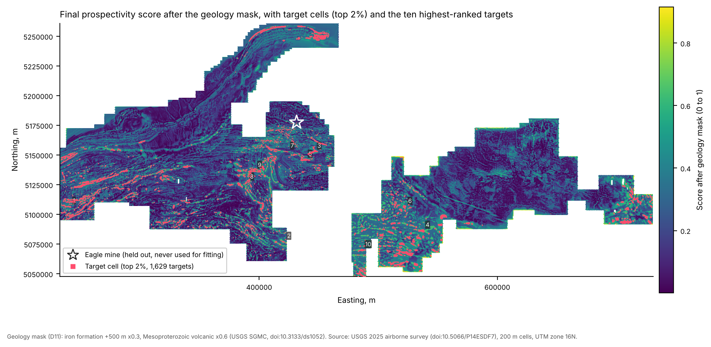

# riftprospect: open prospectivity model for magmatic Ni-Cu-Co-PGE in the Midcontinent Rift

**Status:** Released | v0.1.0 | built 2026-10-27 | **Software DOI:** [10.5281/zenodo.23697827](https://doi.org/10.5281/zenodo.23697827) | **Target table DOI:** [10.5281/zenodo.23697829](https://doi.org/10.5281/zenodo.23697829) | **Map:** [https://bkdanso.github.io/riftprospect/](https://bkdanso.github.io/riftprospect/) | **Maintainer:** Bezali Kwame Danso ([ORCID](https://orcid.org/0009-0006-1201-4129)) | Code MIT, data CC BY-SA 4.0

**In plain terms:** Nickel, cobalt, copper and the platinum-group metals are on the 2025 U.S. critical minerals list. The Eagle mine near Marquette, Michigan, is the only U.S. mine that produces nickel as its main product, and the rock around Lake Superior could hold more deposits like it, mostly hidden under glacial sediment. This project turns free public data into a ranked list of places worth checking. It scores every 200 m square of the 2025 USGS airborne survey of the Upper Peninsula and northern Wisconsin (39,368.6 km², 984,215 squares) by how much its magnetism and natural radioactivity look like the small, dense, magnetic intrusions that host deposits like Eagle. It also tests which rock-chemistry signals actually tell you a deposit is nearby. The Eagle mine was held out of every fitting step. It still ranks at the **98.86th percentile** of the survey area.

New here? Read [docs/START_HERE.md](docs/START_HERE.md). Terms are explained in [docs/GLOSSARY.md](docs/GLOSSARY.md).



## What it found (validation study)

| Test | Result |
|---|---|
| Held-out Eagle mine, final score | 98.86th percentile; captured within the top 1.14% of the area |
| Eagle, range across 200 random weightings | 97.6th to 98.77th percentile |
| Eagle, magnetics only / radiometrics only | 95.6th / 88.44th percentile |
| Chemistry model (Ni/Cu, MgO, Mg-number), spatial cross-validation in Minnesota | AUC 0.29 with near = 3 km (0.48 at 2 km, 0.35 at 5 km; 0.5 = chance): **does not discriminate, and is unstable** |
| Cu/Pd within 3 km of a deposit vs more than 10 km away (igneous rocks) | median 21,736 vs 31,568 (n = 330 vs 138) |
| Targets (top 2% of non-edge squares) | 1,629 targets covering 751.8 km² |

Interpretation and caveats: [docs/LIMITATIONS.md](docs/LIMITATIONS.md). Every modeling choice: [docs/DECISIONS.md](docs/DECISIONS.md).

## Interactive map

Open it at **https://bkdanso.github.io/riftprospect/**. The source is `site/`, a static Leaflet map: score, uncertainty, the 1,629 targets with popups, known deposits, and Cu/Pd sample labels.

## Install and use

```
pip install riftprospect
riftprospect fertility my_samples.csv > fertility.csv
```

`my_samples.csv` needs columns `Cu_ppm, Ni_ppm, Pd_ppb, Pt_ppb, MgO_wt, Fe2O3T_wt` (negative = below detection, as in MCR-GeoChem). Output: Cu/Pd, Ni/Cu, Pd/Pt, Mg-number and a Cu/Pd fertility class per sample.

## Rebuild everything

```
./run_all.sh            # about 1 GB of downloads; about 10 minutes
```

Expected: `paper/stats.json` with 984,215 cells, Eagle at the 98.86th percentile, 1,629 targets, and 14 passing tests.

## Pipeline

| Script | Does |
|---|---|
| `01_fetch.py`, `01b_fetch_sgmc.py` | Download all sources; log size and SHA-256 to `data/raw/PROVENANCE.txt` |
| `02_grid.py` | Average the two survey blocks onto one 200 m grid; analytic signal, residual field, edge distance |
| `03_fertility.py` | Cu/Pd, Ni/Cu, MgO, Mg-number per sample |
| `05_chem_model.py` | Part A: chemistry model trained in Minnesota, spatial cross-validation (reported, not used on the map) |
| `06_geophys.py` | Part B: rule-based geophysics score with Monte Carlo uncertainty |
| `08_combine.py` | Geology mask, targets, held-out Eagle test |
| `09_validate.py` | All validation numbers into `paper/stats.json` |
| `04`, `07`, `10` | Figures and the web map |

## Outputs

| File | One row is |
|---|---|
| `data/processed/targets_ranked.csv` | one target: location, area, peak and mean score, uncertainty, mapped geology, nearby Cu/Pd label |
| `data/processed/prospectivity_cells.parquet` | one 200 m square with every evidence layer and score |
| `data/processed/sample_scores.csv` | one rock sample with indicators and chemistry-model score |
| `paper/stats.json` | every number quoted anywhere |

Column definitions: [docs/CODEBOOK.md](docs/CODEBOOK.md).

## Sources

| Source | Vintage | License |
|---|---|---|
| USGS Critical Mineral Deposits of the United States (Hammarstrom, Woodruff, Dicken and Zach), [doi:10.5066/P9K1HBNT](https://doi.org/10.5066/P9K1HBNT) | ver. 3.0, Sept 2026 | CC0 |
| USGS Airborne magnetic and radiometric survey, Upper Peninsula, Michigan, and parts of northern Wisconsin, 2025 (Drenth, Murchek, Brown and Connell), [doi:10.5066/P14ESDF7](https://doi.org/10.5066/P14ESDF7) | released Sept 2026 | Public domain |
| MCR-GeoChem (Danso and Abdullah), [doi:10.5281/zenodo.23516434](https://doi.org/10.5281/zenodo.23516434) | v1.0.1, Oct 2026 | CC BY-SA 4.0 |
| USGS State Geologic Map Compilation (Horton, San Juan and Stoeser), [doi:10.3133/ds1052](https://doi.org/10.3133/ds1052) | 2017 | Public domain |

## Cite

Software: Danso, B.K. (2026). riftprospect v0.1.0: open prospectivity model for magmatic Ni-Cu-Co-PGE deposits in the Midcontinent Rift. Zenodo. https://doi.org/10.5281/zenodo.23697827

Target table: Danso, B.K. (2026). Ranked prospectivity targets for magmatic Ni-Cu-Co-PGE deposits, Upper Peninsula of Michigan and northern Wisconsin (v0.1.0). Zenodo. https://doi.org/10.5281/zenodo.23697829

See also `CITATION.cff`. Please also cite the sources above.

## AI assistance

Claude (Anthropic) assisted with code, tests and drafting. Bezali Kwame Danso made every modeling decision (docs/DECISIONS.md) and verified the outputs.
